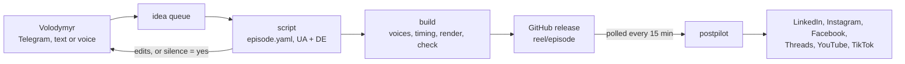

# Beekeeper AI Integrator

[Deutsch](README.de.md)

An episode factory for short animated reels about Pylyp, a Ukrainian beekeeper who now
automates IT in Germany. An idea goes into a Telegram chat; a finished, voiced and
subtitled German reel comes out and is published twice a week, with no manual editing.

The series is the showcase, the pipeline is the work. Bees do the routine, the beekeeper
keeps the blooming field. That is also the offer: I take the routine work of a person or a
company off their hands, and they keep the room for their ideas.

## Watch

| Episode | Where |
| --- | --- |
| 003 "Abend mit Isegrim" (Вечір з Сірим) | [LinkedIn](https://www.linkedin.com/feed/update/urn:li:ugcPost:7532010812069249025) · [YouTube Shorts](https://youtube.com/shorts/qD0Wu-QN9Bw) · [release files](https://github.com/schemchuk/beekeeper-ai-integrator/releases/tag/reel/003-vechir-z-sirym) |
| 002 "Medunko im Winterschlaf" (Медунко в сплячці) | LinkedIn, Instagram, Facebook, Threads (the first reel, 2026-11-25) |

New episodes: Tuesday and Thursday, 08:00 Berlin time. Each reel's files stay public
under [Releases](https://github.com/schemchuk/beekeeper-ai-integrator/releases).

## How it works

Two projects, each with one job. This one makes the reel; my posting bot
[postpilot](https://github.com/schemchuk/postpilot) publishes it.



1. **Ideas.** I send an idea or a tall tale to the factory bot, typed or spoken. Voice is
   transcribed locally (whisper). The text is kept word for word in `bible/`, and the idea
   joins the queue, which gives it a release date.
2. **Script.** At night, three days before release, the factory writes
   `episodes/<nnn>-<slug>/episode.yaml`: scenes, Ukrainian and German lines side by side,
   cover and post text. It must pass `beekeeper validate` before I see it.
3. **Approval.** In the morning the bot sends the script. I answer with edits in
   Ukrainian; the factory re-adapts the German and marks what changed. "погоджую" accepts
   at once; silence accepts it the day before release.
4. **Build.** Voices (local TTS, the main character speaks with my own cloned voice),
   timing and subtitles from the audio, picture in Remotion, then `check` against the
   output contract.
5. **Handoff.** The factory creates a public GitHub release; postpilot picks it up and
   publishes at the release time. "стоп" in the chat withdraws it.

The factory runs on one laptop as a systemd user service. The thinking steps (sorting
messages, scripts, edits) run Claude Code headless on a subscription; everything else is
local and free. Details: [architecture](docs/architecture.md), [running the bot](docs/factory.md).

## The contract with postpilot

The factory never touches postpilot's code, queue or network tokens. It hands over one
GitHub release per episode ([ADR 011](docs/adr/011-handoff-release-contract-v2.md),
postpilot's [publishing contract](https://github.com/schemchuk/postpilot/blob/main/docs/publishing-contract.md)):

```text
release reel/003-vechir-z-sirym    (published, not a draft)
├── manifest.json     {"v": 2, "kind": "reel", "id": "003-vechir-z-sirym",
│                      "release_at": "2026-12-01T08:00:00+01:00", "ai": true}
├── video.mp4         DE reel: H.264, 1080x1920, 30 fps, AAC 48 kHz, 3-90 s
├── cover.png         the cover, also frame 0 of the video
├── post_de.txt       post text, at most 2,157 characters
└── post_threads.txt  only when post_de.txt is over 500 characters
```

The factory checks every limit before it creates the release, so postpilot never has to
reject one. In return postpilot keeps four rules for these reels:

| Rule | postpilot does |
| --- | --- |
| R1 Text as written | posts `post_de.txt` unchanged, no AI rewrite, plus the AI label |
| R2 Our cover | uses `cover.png` as the thumbnail where the network allows it |
| R3 On time | publishes at `release_at`, within about 15 minutes |
| R4 Once only | takes the release by machine; one episode, one ID, never published twice |

## Repository

| Path | What |
| --- | --- |
| `src/beekeeper/` | The pipeline (`voices`, `timing`, `render`, `check`, `build`, `handoff`) and the CLI |
| `src/beekeeper/factory/` | The bot: Telegram, queue, calendar, script, review, production, handoff |
| `prompts/` | The factory's Claude jobs, each with a JSON schema for its answer |
| `episodes/` | One folder per episode: `episode.yaml` |
| `characters/` | Character SVGs and `cast.yaml` (voice per character and language) |
| `animation/` | The Remotion project that draws the reels |
| `bible/` | Series memory: characters, beekeeper's calendar, ideas, my stories |
| `bible/lore/` | Sourced folklore, proverbs, laws and history (UA + DE), machine-readable |
| `factory/` | The factory's state in git: queue and release slots |
| `deploy/` | systemd units for the bot and the weekly temp clean |
| `docs/` | Spec, architecture, ADRs, roadmap, run logs |

## Development

```sh
uv venv --python 3.11
uv pip install -e ".[dev]"
.venv/bin/beekeeper --help
.venv/bin/ruff check . && .venv/bin/pytest -q
(cd animation && npm ci)          # once, for the render step
```

One episode, both languages, in one go (`voices -> timing -> render -> check`; each step
also runs alone, and unchanged work is skipped), then the handoff:

```sh
.venv/bin/beekeeper build episodes/003-vechir-z-sirym
# -> out/003-vechir-z-sirym/reel_de.mp4, reel_ua.mp4, cover_de.png
.venv/bin/beekeeper handoff episodes/003-vechir-z-sirym --release-at 2026-12-01T08:00:00+01:00
```

`check` holds the reels to the output contract: MP4, H.264 yuv420p, 1080x1920, 30 fps,
AAC 48 kHz, 3-90 s, under 20 MB. Needs `ffmpeg`/`ffprobe` on the PATH.

## Principles

- Free and local tools wherever possible; no paid APIs in the render path.
- Original characters and jokes; folklore only from public-domain sources, each with a link.
- Every reel is labelled as AI-generated when published.

## License

- Code (`src/`, `tools/`, `animation/`): [MIT](LICENSE).
- Characters, episodes, scripts and the series bible:
  [CC BY-NC 4.0](LICENSE-CONTENT.md). Share them with credit, no commercial use without permission.

© 2026 Volodymyr Shemchuk
