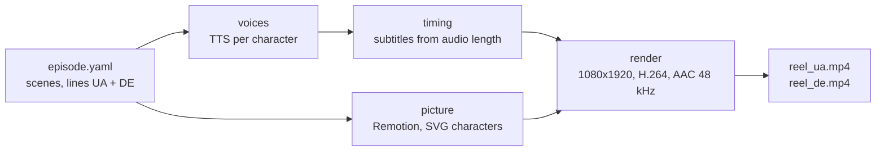

# Beekeeper AI Integrator

An episode factory for short animated reels about Pylyp, a Ukrainian beekeeper who now
automates IT in Germany. One episode file goes in; finished vertical videos in Ukrainian and
German come out, voiced, timed and subtitled, with no manual editing.

The series is the showcase, the pipeline is the work. Bees do the routine, the beekeeper
keeps the blooming field. That is also the offer: I take the routine work of a person or a
company off their hands, and they keep the room for their ideas.

> Status: work in progress. Characters, voice cast and the lore base are done; the render
> pipeline is being built. The first episode made end to end will be linked here.

## How it works

- **Script**: an episode is a YAML file (`episodes/NNN-slug/episode.yaml`), drafted from a
  sourced lore base and the author's own stories.
- **Voices**: free local TTS. HolosTTS for Ukrainian, Chatterbox and Piper for German; the
  main character speaks with the author's own cloned voice.
- **Picture**: SVG characters with named parts (eyes, mouth, arms), animated in Remotion.
- **Output**: ready for LinkedIn, Instagram, Facebook and Threads Reels; published through
  [postpilot](https://github.com/schemchuk), the author's own posting bot.

## Repository

| Path | What |
| --- | --- |
| `episodes/` | One folder per episode: `episode.yaml`, later the rendered reels |
| `characters/` | Character SVGs and `cast.yaml` (voice per character and language) |
| `bible/` | Series memory: characters, beekeeper's calendar, ideas, the author's stories |
| `bible/lore/` | Sourced folklore, proverbs, laws and history (UA + DE), machine-readable |
| `tools/` | Python tools: voice auditions, cast page, model sheet |
| `docs/` | Research notes (TTS engines and choices) |

## Principles

- Free and local tools wherever possible; no paid APIs in the render path.
- Original characters and jokes; folklore only from public-domain sources, each with a link.
- Every reel is labelled as AI-generated when published.

## License

- Code (`tools/`, pipeline): [MIT](LICENSE).
- Characters, episodes, scripts and the series bible:
  [CC BY-NC 4.0](LICENSE-CONTENT.md). Share them with credit, no commercial use without permission.
